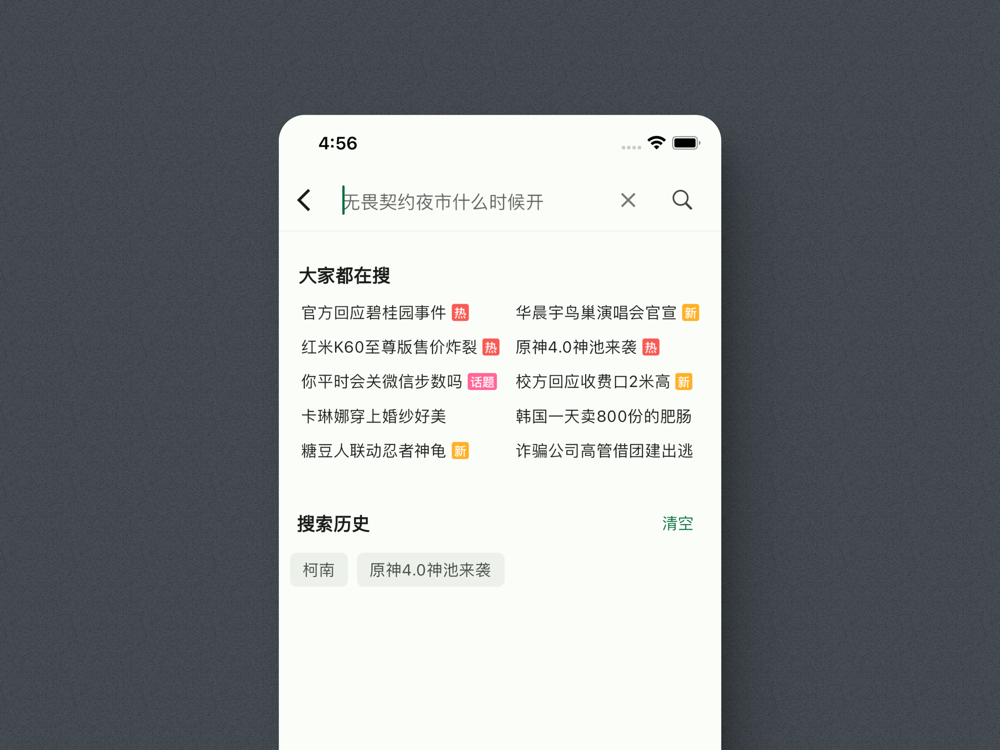
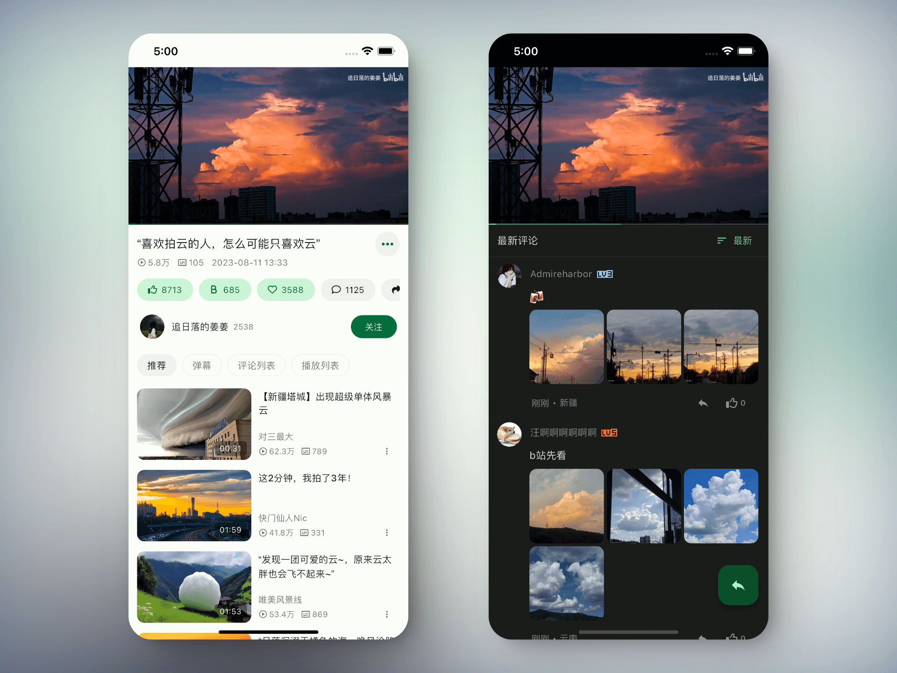
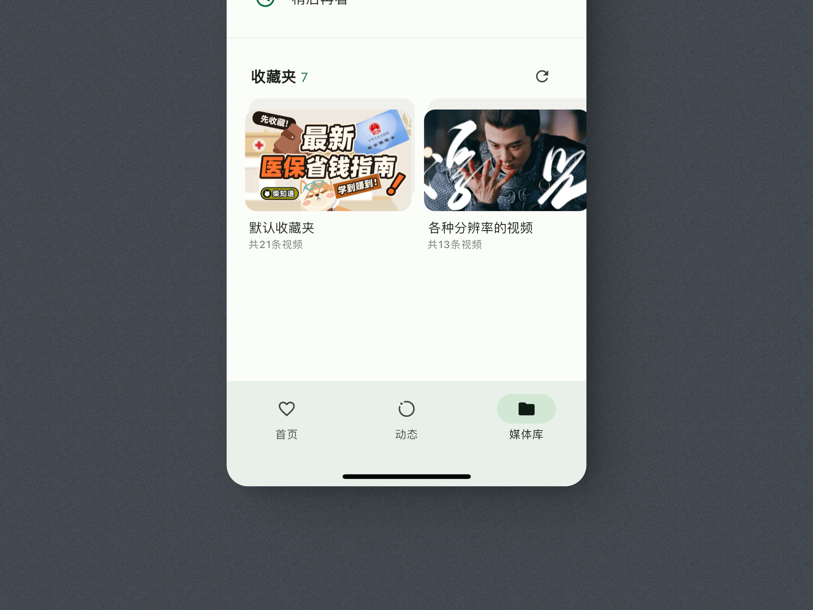
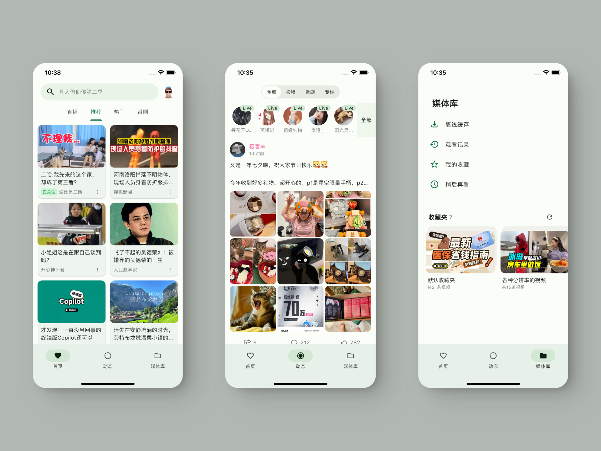

<div align="center">
    
    <h1>PiliPlus</h1>
</div>

<div align="center">

[中文](README.md) | English


</div>

<div align="center">
    <p>A third-party Bilibili client built with Flutter</p>




<br/>

<br/>
</div>

<br/>

> [!NOTE]
> **This is a Liquid Glass fork of [PiliPlus](https://github.com/bggRGjQaUbCoE/PiliPlus).**
>
> Based on upstream `2.1.6`, with an iOS 26-style liquid glass navigation shell applied on top. Everything else matches upstream.
>
> Upstream repository: https://github.com/bggRGjQaUbCoE/PiliPlus

## Liquid Glass

The navigation shell is wrapped in shader-based liquid glass using [`liquid_glass_easy`](https://pub.dev/packages/liquid_glass_easy):

| Surface | Description |
| --- | --- |
| Floating bottom bar | A glass capsule that **refracts the content scrolling behind it** (enable the floating bottom bar setting) |
| Regular bottom bars | Both the `MYBar` and the classic `BottomNavigationBar` are glass-wrapped |
| Side bar | The tablet `NavigationDrawer` is glass-wrapped |
| Dialogs | The confirm and follow-status dialogs are frosted glass panels |

**Rendering**: on Impeller (the default on Android / iOS) the glass refracts the live backdrop. On Skia / Web it degrades gracefully to a frosted look (blur + tint + lit rim) instead of failing.

> [!TIP]
> Only the **floating** bottom bar truly refracts, because it is the only one that floats above the content with something behind it to bend. The regular bars are opaque surfaces, so they read as frosted glass.

### Changed files

```
pubspec.yaml                                    # adds the liquid_glass_easy dependency
lib/common/widgets/glass/glass_surface.dart     # reusable GlassSurface widget
lib/common/widgets/floating_navigation_bar.dart # glass floating bottom bar
lib/common/widgets/dialog/dialog.dart           # glass dialogs
lib/pages/main/view.dart                        # glass regular bottom bars / sidebar
.github/workflows/build_android.yml             # Android APK build workflow
```

## Building

This project **requires a patched Flutter SDK** (upstream exposes several framework-private APIs through `lib/scripts/patch.ps1`). Building without patching fails, so the patch step is mandatory.

```bash
# 1. Install the Flutter version pinned in pubspec.yaml (3.47.6)
fvm install          # or install that version manually

# 2. Apply the SDK patches (required; also re-runs flutter pub get)
pwsh lib/scripts/patch.ps1 android

# 3. Build
flutter build apk --release --split-per-abi
```

GitHub Actions runs the whole flow already (see [build_android.yml](.github/workflows/build_android.yml)) and uploads the APK artifacts on every push.

## Download

Download a build from [Releases](https://github.com/bggRGjQaUbCoE/PiliPlus/releases), or clone the repository and build it locally.

## Disclaimer

PiliPlus is a personal project developed for educational purposes, intended only for learning and testing. Please delete it within 24 hours of downloading.
All APIs used were collected from the official website. This project does not provide any cracked content.

Credit to the original project: [guozhigq/pilipala](https://github.com/guozhigq/pilipala).
Credit to the upstream project: [orz12/PiliPalaX](https://github.com/orz12/PiliPalaX).
This repository makes more extensive changes. Thank you to the original authors for sharing their work as open source.

Thank you for using PiliPlus.

## Acknowledgements

- [bilibili-API-collect](https://github.com/SocialSisterYi/bilibili-API-collect)
- [flutter_meedu_videoplayer](https://github.com/zezo357/flutter_meedu_videoplayer)
- [media-kit](https://github.com/media-kit/media-kit)
- [dio](https://pub.dev/packages/dio)
- And others

## Star History

<a href="https://star-history.dera.page/#XRC111/plilplus-flutter-plus&Date">
 <picture>
   <source media="(prefers-color-scheme: dark)" srcset="https://star-history.dera.page/svg?repos=XRC111/plilplus-flutter-plus&type=Date&theme=dark" />
   <source media="(prefers-color-scheme: light)" srcset="https://star-history.dera.page/svg?repos=XRC111/plilplus-flutter-plus&type=Date" />
   
 </picture>
</a>