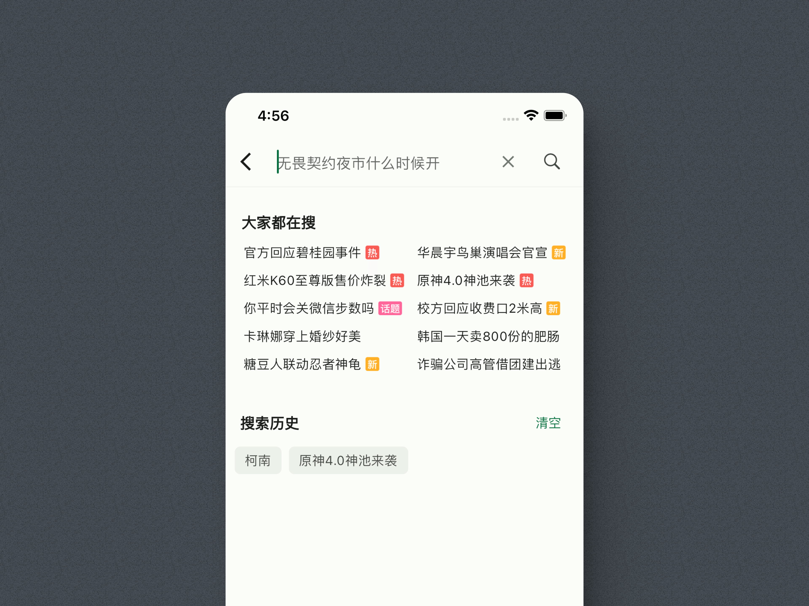
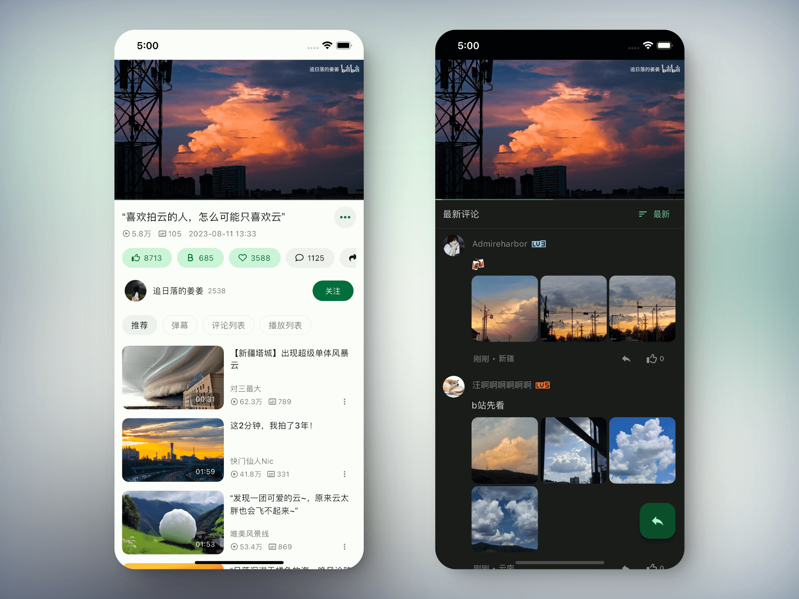

<div align="center">


# PiliPlus · Liquid Glass

**哔哩哔哩第三方客户端（Flutter）的 iOS 26 液态玻璃改造分支**

中文 | [English](README.en.md)

[](https://github.com/XRC111/plilplus-flutter-plus/actions/workflows/build_android.yml)
[](https://github.com/XRC111/plilplus-flutter-plus/stargazers)
[](./LICENSE)





</div>

---

> [!NOTE]
> 这是 [PiliPlus](https://github.com/bggRGjQaUbCoE/PiliPlus) 的**液态玻璃（Liquid Glass）改造分支**，基于上游 `2.1.6`。除下述改动外，功能与上游一致。
>
> 上游仓库：<https://github.com/bggRGjQaUbCoE/PiliPlus>

## 这个分支改了什么

用 [`liquid_glass_easy`](https://pub.dev/packages/liquid_glass_easy) 给导航外壳套上基于着色器的液态玻璃：

| 部分 | 说明 |
| --- | --- |
| 悬浮底栏 | 玻璃胶囊，**实时折射**背后滚动的内容（需开启「悬浮底栏」设置） |
| 常规底栏 | `MYBar` 与经典 `BottomNavigationBar` 两种模式均已套用 |
| 侧边栏 | 平板模式下的 `NavigationDrawer` 已套用 |
| 对话框 | 确认框、追番状态选择框改为磨砂玻璃面板 |

**渲染表现**：Impeller（Android / iOS 默认）上玻璃实时折射背景；Skia / Web 自动降级为磨砂玻璃（模糊 + 着色 + 边缘高光），不会报错。

> 玻璃效果**只在「悬浮底栏」模式下才有折射**——只有它悬浮在内容之上，背后有内容可折射。常规底栏是不透明表面，视觉上是磨砂玻璃。

### 改动文件

```
pubspec.yaml                                     # 新增 liquid_glass_easy 依赖
lib/common/widgets/glass/glass_surface.dart      # 可复用玻璃组件 GlassSurface
lib/common/widgets/floating_navigation_bar.dart  # 悬浮底栏玻璃化
lib/common/widgets/dialog/dialog.dart            # 对话框玻璃化
lib/pages/main/view.dart                         # 常规底栏 / 侧边栏玻璃化
.github/workflows/build_android.yml              # Android APK 构建流程
```

## 构建

本项目**依赖打过补丁的 Flutter SDK**（上游通过 `lib/scripts/patch.ps1` 暴露若干框架私有 API），直接构建会报错，必须先应用补丁。

```bash
# 1. 安装与 pubspec.yaml 一致的 Flutter 版本（3.47.6）
fvm install

# 2. 应用 SDK 补丁（必须，之后要重跑 pub get）
pwsh lib/scripts/patch.ps1 android

# 3. 构建
flutter build apk --release --split-per-abi
```

GitHub Actions 已配置完整流程（[build_android.yml](.github/workflows/build_android.yml)），推送代码自动构建并上传 APK。

## 下载

- 从 [Actions](https://github.com/XRC111/plilplus-flutter-plus/actions/workflows/build_android.yml) 下载自动构建的 APK
- 或克隆仓库后本地编译

## 适配平台

- [x] Android
- [x] iOS
- [x] Pad
- [x] Windows
- [x] Linux

## 功能

完整功能清单（沿用上游，已折叠）：

<details>
<summary>展开查看全部功能</summary>

**内容浏览**

- [x] 推荐视频列表（App 端）、最热视频、热门直播、番剧列表
- [x] 屏蔽黑名单用户视频、无痕模式、游客模式
- [x] 搜索：热搜、历史、默认搜索词、投稿/番剧/直播/用户搜索、排序与时长筛选

**用户与社交**

- [x] 用户主页、关注/取关、粉丝与拉黑列表
- [x] 离线缓存、稍后再看、观看记录、我的收藏
- [x] 站内私信：发图、删除/置顶/撤回、举报
- [x] 动态：分类查看、评论与回复、转发、话题、图文
- [x] 多账号支持、WebDAV 备份/恢复

**视频播放**

- [x] 双击快进/暂停、垂直调亮度/音量、水平手势快进
- [x] 倍速、长按 2 倍速、画质/音质/解码选择、记忆播放
- [x] 弹幕（含高级弹幕、合并弹幕、彩色弹幕）、字幕、投屏（DLNA）
- [x] 超分辨率、Live Photo、视频截取动图、跳过片头片尾
- [x] 互动视频、播放课堂视频、AI 原声翻译

**评论与动态**

- [x] 楼中楼查看/定位/排序、点踩、带图评论、笔记
- [x] 编辑动态、发布/删除/置顶动态、富文本编辑与 @ 用户
- [x] 三连动画、投币动画、SponsorBlock

**其他**

- [x] 收藏夹/稍后再看的多选、复制、移动、排序
- [x] 创建/编辑/删除收藏夹、关注分组、修改个人资料
- [x] Cookie 登录、Win/Mac 极验与短信登录
- [x] WebDAV 备份、设置项齐全（画质/主题/震动/高帧率/横屏）

</details>

## 声明

本项目为个人兴趣开发，仅用于学习和测试，请于下载后 24 小时内删除。所用 API 均从官方网站收集，不提供任何破解内容。

致敬原作者：[guozhigq/pilipala](https://github.com/guozhigq/pilipala)、[orz12/PiliPalaX](https://github.com/orz12/PiliPalaX)、[bggRGjQaUbCoE/PiliPlus](https://github.com/bggRGjQaUbCoE/PiliPlus)。

## 致谢

- [bilibili-API-collect](https://github.com/SocialSisterYi/bilibili-API-collect)
- [media-kit](https://github.com/media-kit/media-kit)
- [flutter_meedu_videoplayer](https://github.com/zezo357/flutter_meedu_videoplayer)
- [dio](https://pub.dev/packages/dio)
- [liquid_glass_easy](https://pub.dev/packages/liquid_glass_easy)

## HarmonyOS / OpenHarmony

仓库内附了一套**独立的鸿蒙构建流水线**（`.github/workflows/build-harmonyos.yml`），
产物是可直接安装的 **未签名 HAP**（真机安装需用 DevEco Studio 自行配签名）。

### 当前状态：可浏览内容的真实客户端

主工程 14 个自定义 git fork 插件（`audio_service`、`canvas_danmaku`、`getx`、
`flutter_inappwebview`、`media_kit` 系列等）经 GitHub API 逐个核实**全部没有 ohos 实现**，
直接 `flutter pub get` 会失败。但主工程 `lib/` 下 **1331 个 Dart 文件里有 1255 个是纯 Dart**
（网络 / 模型 / 工具 / UI），与平台无关。

因此鸿蒙版不再只放占位骨架，而是用**纯 Dart 依赖重建了真实的 B 站业务层**：

| 文件 | 作用 |
| --- | --- |
| `pubspec.harmony.yaml` | 鸿蒙专用依赖：`dio` / `collection` / `intl` / `flutter_localizations` |
| `lib/harmony/api.dart` | B 站公开 API 客户端：推荐、热门、排行榜、搜索、视频详情、评论、动态、UP 主 |
| `lib/harmony_main.dart` | 完整 UI：五 Tab 导航、无限滚动、下拉刷新、视频卡片、详情页（分 P / 统计 / 评论）、错误重试、深色模式 |
| `scripts/harmony/setup-sdk.sh` | HarmonyOS Command Line Tools 多镜像下载与布局适配 |
| `scripts/harmony/fix-profile.cjs` | 修正生成的 `build-profile.json5` 的 SDK 版本格式 |
| `.github/workflows/build-harmonyos.yml` | 完整构建流水线（会一并复制 `lib/harmony/*.dart`） |

已实现的功能：首页推荐（分页）、热门、全站排行榜、关键词搜索、动态流、
视频详情页（封面 / 标题 / UP 主 / 播放·弹幕·点赞·投币·收藏·评论数 / 简介 / 分 P 列表 / 评论）。
所有列表均有加载态、错误态与重试，网络失败不会白屏。

### 没有原生模块就自己实现

14 个插件没有 ohos 实现，但**不等于对应功能就做不了**。原则是：能靠纯 Dart / Flutter
自身完成的，一律自己实现，不等插件；只有真正需要平台通道的才另想办法。

已完成两块：

| 能力 | 原插件 | 自研实现 | 为什么不需要原生 |
| --- | --- | --- | --- |
| 图片缓存 | `cached_network_image_ce` | `lib/harmony/image_cache.dart`：`HttpClient` + 24 MB 内存 LRU + 在途请求合并 + 占位/错误态 | 网络下载与内存缓存都是纯 Dart；`dart:io` 在 Flutter-OH 上可用（已由 CI 验证） |
| 弹幕 | `canvas_danmaku` | `lib/harmony/danmaku.dart`：拉取 `/x/v1/dm/list.so` 的 XML，用 `CustomPainter` + `AnimationController` 自己绘制滚动/顶部/底部弹幕，含轨道分配、描边、暂停 | 弹幕本质是 2D 文字绘制，Flutter 自带渲染管线即可 |

**仍未覆盖**：视频播放（`media_kit` + libmpv）、投屏、扫码登录、本地下载、图片保存。
这些确实需要 HarmonyOS 原生 API（如 `AVPlayer`），下一步需要把 `flutter create`
临时生成的 ohos 工程骨架固化进仓库、写 ArkTS `MethodChannel` 桥接，属于另一阶段工作。

> 已知限制：弹幕 XML 用纯 Dart 的 `charset` 包做 GBK 解码，中文可正常显示；
> 弹幕绘制性能与图片缓存命中率均**只过编译验证，待真机确认**。

构建在临时目录里 `flutter create --platforms=ohos` 生成工程后再 `flutter build hap`，
产物约 **7.8 MB**，主工程源码原样保留在 `lib/`。

### 为什么选 `oh-3.22.3`

HuggingFace 上的 `command-line-tools` 最高只到 **6.0.1.251（API 21）**，
而 CPF-Flutter 的 `oh-3.41.9-release` 引擎用到了 `CompetitionStrategy`、
`Window.isInFreeWindowMode` 等**更新版本**的 HarmonyOS API，在 API 21 上 ArkTS 编译直接失败。
因此流水线优先使用 `harmonycommando` 的 **`oh-3.22.3`**（面向 HarmonyOS 5.x/6.0），
CPF 分支作为候选保留，等 SDK 升级后可直接切换。

### 后续路径

1. 等 CPF-Flutter 生态补齐播放器 / 弹幕 / 投屏等插件的 ohos 实现；
2. 逐个把 `pubspec.harmony.yaml` 的依赖换回主工程版本，接回 `lib/` 完整入口；
3. 播放器（`media_kit` + `libmpv`）与弹幕是需要优先突破的两块。

已完成的调查：用 GitHub API 检查了 14 个自定义 fork 仓库的根目录，
**全部没有 `ohos/` 目录**，因此「直接复用主工程入口」这条路目前不可行。

> 说明：鸿蒙流水线只做过编译验证，**未在真机运行**。
## Star History

<a href="https://star-history.dera.page/#XRC111/plilplus-flutter-plus&Date">
 <picture>
   <source media="(prefers-color-scheme: dark)" srcset="https://star-history.dera.page/svg?repos=XRC111/plilplus-flutter-plus&type=Date&theme=dark" />
   <source media="(prefers-color-scheme: light)" srcset="https://star-history.dera.page/svg?repos=XRC111/plilplus-flutter-plus&type=Date" />
   
 </picture>
</a>
